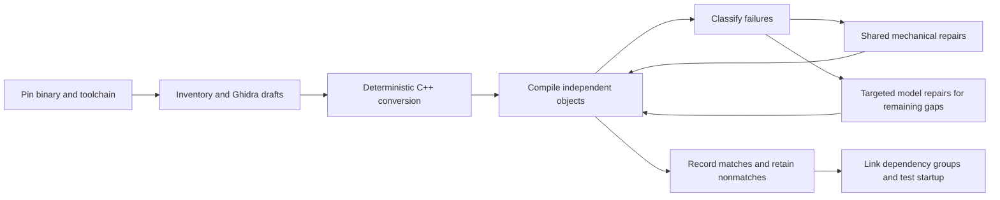

# A reproducible, low-cost decompilation workflow

This is the evolving method developed in DAODecomp, intended to help other game
decompilation projects reproduce both the useful results and the mistakes. It is
not yet a turnkey framework for arbitrary games. Our implementation currently
targets one pinned Windows x86 executable, and we have **not** demonstrated a
runnable replacement for the whole game or completion within $200.

The goal is functional recovery and a replacement using the original assets.
Exact compiled-function matches are a useful automatic acceptance shortcut; a
byte-identical whole executable is not required. Read the
[learning log](learning-log.md) for dated observations and the
[cost plan](cost-target.md) for measurements and budget assumptions.

## The inexpensive order of work



Do not make every function depend on a model call. Do not make generation wait
for every dependency implementation or for handwritten validation material.
Keep compiling sources and useful nonmatches even when matching or execution
checking is not yet supported. Stable address names are sufficient initially;
readability and naming can improve after behavior and integration become clearer.

## 1. Pin the input and inventory what is actually known

Record the executable/module hash, image base, architecture, endianness and
analysis/tool versions. Identify a function with **module hash + module + RVA**.
A VA includes the image base; an RVA does not. Use a single canonical identity
through source names, call/global references, compiler symbols and comparisons.

Export inferred function starts, complete body ranges, raw-byte hashes, direct
calls, imports, referenced data and prototype/type hypotheses automatically.
Keep unknown boundaries, indirect calls, shared tails and missing functions
explicit. A decompiler's function count and prototypes are not ground truth.
Do not exclude difficult functions from the inventory because the first backend
cannot yet compare them.

For the actual DAO import/export procedure and pinned Ghidra distribution, see
[static analysis](static-analysis.md). Original binaries, assets, generated Ghidra
projects, full disassembly and raw evidence stay in ignored local storage. Public
documentation can include source transformations, aggregate metrics and small
synthetic examples without shipping the game's install.

## 2. Produce free drafts, then mechanically normalize them

Use headless decompilation once and retain its output. Export referenced symbols
and data types with each draft so downstream tools do not need to rediscover
identities. Save per-function errors/timeouts as outcomes rather than dropping
identities from the denominator.

Bootstrap C++ syntax with narrow token-aware rules. Examples include canonical
address names, recognized integer-width aliases and well-understood parameter
declaration forms. Comments, strings and longer identifiers must not be rewritten
accidentally. Missing register/stack inputs cannot be replaced with invented values.

Use target-aware AST analysis when the edit depends on expression structure,
pointer width, signedness, lvalues or a calling convention. Get enough declarations
and syntax into shape first: an incomplete recovery AST does not justify arbitrary
rewrites. Keep unsupported cases visible. The current
[compile-first work](compile-first.md) uses the existing Clang executable for AST
information and the historical compiler for final object production.

## 3. Compile without requiring the whole game to link

Generate standalone translation units with provisional dependency declarations,
then compile to objects without linking. This permits caller and callee recovery
in parallel. Declarations are not successful stub implementations.

Select a plausible original compiler family, target, patch and flags using binary
evidence and measured output. Preserve the uncertainty: a PE linker version does
not identify the exact C++ compiler patch. Record the compiler executable identity,
flags and actual build host. Our VC8 x86 compiler runs under Windows 11 ARM64
translation, which is distinct from running on native x86 hardware.

Classify **the first compiler error in each file** as well as the complete log.
One bad declaration can produce dozens of cascading diagnostics. Group repairs
by root cause and use shared transformations rather than one model request per
error message. Rebuild every changed candidate. A separate baseline makes repair
yield and regressions measurable.

Do not treat every decompiler state placeholder alike. Our next round separated
byte-backed `FS:[0]` memory operations from genuinely unresolved register/stack
inputs and lowered the supported accesses to native compiler intrinsics. This
exposed compiler-cookie frame addresses as a separate problem. Keep a complete
inventory while deferring known failures from the next expensive compiler pass;
record the deterministic selection rule and preserve the omitted identities.
See the [FS round and its limits](compile-first.md#round-002-explicit-fs-memory-access).

Before changing a failed call, check declaration closure against the retained
analysis metadata. The [callback declaration pass](compile-first.md#round-005-restore-omitted-callback-typedef-declarations)
restores only omitted numeric callback typedefs with explicit supported signatures
from the same read-only project revision. Missing metadata remains unknown. Its
75/80 compilation improvement produced zero new exact matches, demonstrating why
compilation repair and matching yield need separate denominators.

## 4. Keep compilation, comparison and execution separate

| State | What has actually been observed |
| --- | --- |
| Draft | A decompiler or model emitted a hypothesis |
| C++ emitted | The converter produced source, possibly still invalid |
| Object compiled | The selected compiler accepted the source |
| Full function match | The comparison covered the full supported original range and resolved references under its recorded rules |
| Linked slice | Dependencies and definitions were sufficient for a particular executable build |
| Runtime milestone | That executable actually reached a specified behavior on a recorded host |

Never turn a rounded similarity score, matching prefix, unresolved relocation,
missing symbol, solver timeout or unsupported case into a match. For object
comparison, resolve supported relocations to explicit original identities and
check addends; do not merely mask address operands. The current
[object comparator](object-recovery.md) and earlier [reccmp loop](reccmp-loop.md)
describe their different scopes and limitations.

Use common comparator tests and negative controls to catch false acceptance.
Do not require a handwritten contract, fixture corpus, wrapper and review packet
for every new function. Generated evidence should bind source, original bytes,
compiler/object and comparison inputs automatically. Compilable nonmatches remain
valuable working material, but are not silently upgraded to equivalence.

For already-compiling near nonmatches, try a bounded deterministic AST search
before individual model repair. Our [matching pilot](compile-first.md#bounded-ast-guided-matching-pilot)
uses complete target-aware parses, actual integer types and source spans, a fixed
frontier and at most four variants per pilot function. Comparison and signedness
edits are candidate hypotheses, so every failed variant remains unvalidated.
Instruction similarity only ranks work; a full-range exact object comparison
still decides acceptance. Preserve known exact controls and count every compiler
attempt, including failed exploratory smoke work.

## 5. Spend inference on diagnosed gaps

Send a model the current draft/source, requested identities, relevant dependency
information and concrete compiler/comparison feedback. Keep complete evidence
locally while avoiding repeated caller lists and unrelated metadata in prompts.
Never truncate the requested function's necessary context without recording that
generation is incomplete.

Measure tokens and outcome separately: reasoning tokens, source output, cache
hits, invalid responses, compilations and **new distinct** matches. A mode that
uses fewer tokens can still cost more per useful result. Our non-thinking pilot
did not justify a wholesale switch away from the prior mode.

Bound retries and stop plateaus. Do not pay a model to fix an unsupported
comparator case, a missing compiler install or a known transport problem. Keep
successful paid responses when only later tooling failed. An ambiguous timeout
must not silently cause a duplicate paid request. Reserve budget before dispatch
and preserve accounting across restarts, splits and repairs.

## 6. Integrate before the budget is exhausted

Objects can compile with contradictory declarations, repeated definitions and
missing data. Generate a canonical definition/dependency inventory; expose ABI,
type and data-layout conflicts rather than selecting whichever version links.
Work outward through coherent startup and application dependency groups.

Track actual milestones: linked startup, original-asset access, menu, save loading,
then specified gameplay scenarios. CRT initialization, globals, imports, TLS,
vtables, exceptions and middleware are real work beyond isolated functions.
Unrecovered dependencies cannot be replaced by success-returning stubs. A hybrid
that still executes original code must be labeled as such.

Reserve inference and engineering effort for integration. Thousands of easy leaf
matches do not establish that complex functions or the whole game will have the
same cost per function.

## Reproducing the current DAO experiment

The repository still contains machine-specific configuration. Use the existing
Python dependencies, analyzed project and Windows compiler described in
[static analysis](static-analysis.md) and [object recovery](object-recovery.md).
For a bounded free sample, from the configured worktree:

```sh
python -m rapid_object.ghidra_seed select --root local/repro-seed --count 200
python -m rapid_object.ghidra_seed export --root local/repro-seed
python -m rapid_object.ghidra_seed convert --root local/repro-seed
python -m rapid_object.ghidra_seed measure --root local/repro-seed
```

The measurement command requires the paid queue to be paused and drained and
shares the VM build lock. These commands make no provider calls or production
match promotions. The Java exporter bounds each invocation to 1,000 RVAs; the
recorded whole-inventory run used 28 chunks. Full export is not full compilation.

Version the input binary, persistent analysis state, exporter, converter, compiler,
flags and comparator. A cache entry must correspond to the actual current source
bytes; a cached status or pathname alone is insufficient. Preserve historical
measurements when a converter changes instead of relabeling them as fresh runs.

## Adapting it to another game

| Assumption to replace or verify | Current implementation locations |
| --- | --- |
| Module hash, inventory and runtime paths | `rapid/packets.py`, `rapid/factory.py`, `rapid_object/catalog.py` |
| Ghidra project, language/compiler specification, exporter bounds | `rapid_object/ghidra_seed.py`, `tools/ghidra/ExportInventory.java`, `tools/ghidra/ExportCandidates.java` |
| Source marker/project identity and stable-name mapping | `rapid_native/response.py`, `rapid_object/build.py`, `rapid_object/symbol_normalize.py` |
| Historical compiler, build flags and VM transport | `rapid_object/build.py`, `rapid_native/pipeline.py` |
| Object format, ISA, relocation semantics and body boundaries | `rapid_object/coff.py`, `rapid_object/compare.py` |
| Target widths, calling conventions and source conversion rules | `rapid_object/ghidra_seed.py`, the additive compile-repair pass |
| Model, request schema, limits, prices and credentials | `rapid_native/propose.py`, `workers/deepseek_packet.py` |

Changing only the executable filename is not a port. In particular, x86 COFF
relocation rules and 32-bit pointer transformations must not be reused unchanged
for another architecture. First reproduce a small stratified sample and known
negative cases on the new target, then expand. Keep the per-game differences
explicit; a reusable configuration interface can follow demonstrated second-game
requirements instead of being designed speculatively now.

## How to add a learning

Append a concise entry to [the learning log](learning-log.md) when an experiment
or fix changes what we know. Include the symptom and general cause, the rule and
its preconditions, the measured before/after denominator, reproduction/code links,
and what remains unresolved. Record failed experiments too. Add generic synthetic
regression cases for reusable transformations, not bespoke paperwork per game
function. This documentation is part of the ongoing work.
