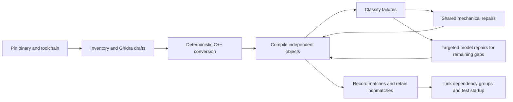

# A reproducible, low-cost decompilation workflow

This is the evolving method developed in DAODecomp, intended to help other game
decompilation projects reproduce both the useful results and the mistakes. It is
not yet a turnkey framework for arbitrary games. Our implementation currently
targets one pinned Windows x86 executable, and we have **not** demonstrated a
runnable replacement for the whole game or completion within $200.

The goal is functional recovery and a replacement using the original assets.
Exact compiled-function matches are a useful automatic acceptance shortcut; a
byte-identical whole executable is not required. Read the
[learning log](learning-log.md) for dated observations and the
[cost plan](cost-target.md) for measurements and budget assumptions.

The first [C# MCP implementation](decompilation-mcp-usage.md) exposes inventory,
retained C++ and fresh checks of existing compiler artifacts to agent clients.
It shares the current comparison backends; installing it does not yet add new
compilation, automatic source rewriting or a game-independent decompiler.

## The inexpensive order of work



Do not make every function depend on a model call. Do not make generation wait
for every dependency implementation or for handwritten validation material.
Keep compiling sources and useful nonmatches even when matching or execution
checking is not yet supported. Stable address names are sufficient initially;
readability and naming can improve after behavior and integration become clearer.

## 1. Pin the input and inventory what is actually known

Record the executable/module hash, image base, architecture, endianness and
analysis/tool versions. Identify a function with **module hash + module + RVA**.
A VA includes the image base; an RVA does not. Use a single canonical identity
through source names, call/global references, compiler symbols and comparisons.

Export inferred function starts, complete body ranges, raw-byte hashes, direct
calls, imports, referenced data and prototype/type hypotheses automatically.
Keep unknown boundaries, indirect calls, shared tails and missing functions
explicit. A decompiler's function count and prototypes are not ground truth.
Do not exclude difficult functions from the inventory because the first backend
cannot yet compare them.

For the actual DAO import/export procedure and pinned Ghidra distribution, see
[static analysis](static-analysis.md). Original binaries, assets, generated Ghidra
projects, full disassembly and raw evidence stay in ignored local storage. Public
documentation can include source transformations, aggregate metrics and small
synthetic examples without shipping the game's install.

## 2. Produce free drafts, then mechanically normalize them

Use headless decompilation once and retain its output. Export referenced symbols
and data types with each draft so downstream tools do not need to rediscover
identities. Save per-function errors/timeouts as outcomes rather than dropping
identities from the denominator.

Bootstrap C++ syntax with narrow token-aware rules. Examples include canonical
address names, recognized integer-width aliases and well-understood parameter
declaration forms. Comments, strings and longer identifiers must not be rewritten
accidentally. Missing register/stack inputs cannot be replaced with invented values.

Use target-aware AST analysis when the edit depends on expression structure,
pointer width, signedness, lvalues or a calling convention. Get enough declarations
and syntax into shape first: an incomplete recovery AST does not justify arbitrary
rewrites. Keep unsupported cases visible. The current
[compile-first work](compile-first.md) uses the existing Clang executable for AST
information and the historical compiler for final object production.

## 3. Compile without requiring the whole game to link

Generate standalone translation units with provisional dependency declarations,
then compile to objects without linking. This permits caller and callee recovery
in parallel. Declarations are not successful stub implementations.

Select a plausible original compiler family, target, patch and flags using binary
evidence and measured output. Preserve the uncertainty: a PE linker version does
not identify the exact C++ compiler patch. Record the compiler executable identity,
flags and actual build host. Our VC8 x86 compiler runs under Windows 11 ARM64
translation, which is distinct from running on native x86 hardware.

Classify **the first compiler error in each file** as well as the complete log.
One bad declaration can produce dozens of cascading diagnostics. Group repairs
by root cause and use shared transformations rather than one model request per
error message. Rebuild every changed candidate. A separate baseline makes repair
yield and regressions measurable.

Do not treat every decompiler state placeholder alike. Our next round separated
byte-backed `FS:[0]` memory operations from genuinely unresolved register/stack
inputs and lowered the supported accesses to native compiler intrinsics. This
exposed compiler-cookie frame addresses as a separate problem. Keep a complete
inventory while deferring known failures from the next expensive compiler pass;
record the deterministic selection rule and preserve the omitted identities.
See the [FS round and its limits](compile-first.md#round-002-explicit-fs-memory-access).

Before changing a failed call, check declaration closure against the retained
analysis metadata. The [callback declaration pass](compile-first.md#round-005-restore-omitted-callback-typedef-declarations)
restores only omitted numeric callback typedefs with explicit supported signatures
from the same read-only project revision. Missing metadata remains unknown. Its
75/80 compilation improvement produced zero new exact matches, demonstrating why
compilation repair and matching yield need separate denominators.

## 4. Keep compilation, comparison and execution separate

| State | What has actually been observed |
| --- | --- |
| Draft | A decompiler or model emitted a hypothesis |
| C++ emitted | The converter produced source, possibly still invalid |
| Object compiled | The selected compiler accepted the source |
| Full function match | The comparison covered the full supported original range and resolved references under its recorded rules |
| Linked slice | Dependencies and definitions were sufficient for a particular executable build |
| Runtime milestone | That executable actually reached a specified behavior on a recorded host |

Never turn a rounded similarity score, matching prefix, unresolved relocation,
missing symbol, solver timeout or unsupported case into a match. For object
comparison, resolve supported relocations to explicit original identities and
check addends; do not merely mask address operands. The current
[object comparator](object-recovery.md) and earlier [reccmp loop](reccmp-loop.md)
describe their different scopes and limitations.

Use common comparator tests and negative controls to catch false acceptance.
Do not require a handwritten contract, fixture corpus, wrapper and review packet
for every new function. Generated evidence should bind source, original bytes,
compiler/object and comparison inputs automatically. Compilable nonmatches remain
valuable working material, but are not silently upgraded to equivalence.

For already-compiling near nonmatches, try a bounded deterministic AST search
before individual model repair. Our [matching pilot](compile-first.md#bounded-ast-guided-matching-pilot)
uses complete target-aware parses, actual integer types and source spans, a fixed
frontier and at most four variants per pilot function. Comparison and signedness
edits are candidate hypotheses, so every failed variant remains unvalidated.
Instruction similarity only ranks work; a full-range exact object comparison
still decides acceptance. The [indirect receiver follow-up](compile-first.md#bind-indirect-receiver-hypotheses-to-the-observed-call-edge)
shows why a memory-addressing label can require restoring an observed call input
rather than changing field offsets. Its bounded AST rule retains unknown callee
semantics and relies on the same complete comparator. Preserve known exact
controls and count every compiler attempt, including failed exploratory smoke work.

## 5. Spend inference on diagnosed gaps

First run a [deterministic mismatch census](mismatch-analysis.md) over retained
objects. Rank observed differences by both function count and requested body
bytes, excluding identities already matched by another candidate. Keep broad
heuristic labels separate from small, aligned repair frontiers: a primary
stack-cleanup label can coexist with substantial structural differences. Preserve
unsupported comparisons and unknown causes. Typed paired IL is a further
diagnostic layer; do not silently promote structural agreement to equivalence.

Send a model the current draft/source, requested identities, relevant dependency
information and concrete compiler/comparison feedback. Keep complete evidence
locally while avoiding repeated caller lists and unrelated metadata in prompts.
Never truncate the requested function's necessary context without recording that
generation is incomplete.

Measure tokens and outcome separately: reasoning tokens, source output, cache
hits, invalid responses, compilations and **new distinct** matches. A mode that
uses fewer tokens can still cost more per useful result. Our non-thinking pilot
did not justify a wholesale switch away from the prior mode.

Bound retries and stop plateaus. Do not pay a model to fix an unsupported
comparator case, a missing compiler install or a known transport problem. Keep
successful paid responses when only later tooling failed. An ambiguous timeout
must not silently cause a duplicate paid request. Reserve budget before dispatch
and preserve accounting across restarts, splits and repairs.

## 6. Integrate before the budget is exhausted

Objects can compile with contradictory declarations, repeated definitions and
missing data. Generate a canonical definition/dependency inventory; expose ABI,
type and data-layout conflicts rather than selecting whichever version links.
Work outward through coherent startup and application dependency groups.

Track actual milestones: linked startup, original-asset access, menu, save loading,
then specified gameplay scenarios. CRT initialization, globals, imports, TLS,
vtables, exceptions and middleware are real work beyond isolated functions.
Unrecovered dependencies cannot be replaced by success-returning stubs. A hybrid
that still executes original code must be labeled as such.

Reserve inference and engineering effort for integration. Thousands of easy leaf
matches do not establish that complex functions or the whole game will have the
same cost per function.

## Reproducing the current DAO experiment

The repository still contains machine-specific configuration. Use the existing
Python dependencies, analyzed project and Windows compiler described in
[static analysis](static-analysis.md) and [object recovery](object-recovery.md).
For a bounded free sample, from the configured worktree:

```sh
python -m rapid_object.ghidra_seed select --root local/repro-seed --count 200
python -m rapid_object.ghidra_seed export --root local/repro-seed
python -m rapid_object.ghidra_seed convert --root local/repro-seed
python -m rapid_object.ghidra_seed measure --root local/repro-seed
```

The measurement command requires the paid queue to be paused and drained and
shares the VM build lock. These commands make no provider calls or production
match promotions. The Java exporter bounds each invocation to 1,000 RVAs; the
recorded whole-inventory run used 28 chunks. Full export is not full compilation.

Version the input binary, persistent analysis state, exporter, converter, compiler,
flags and comparator. A cache entry must correspond to the actual current source
bytes; a cached status or pathname alone is insufficient. Preserve historical
measurements when a converter changes instead of relabeling them as fresh runs.

## Adapting it to another game

| Assumption to replace or verify | Current implementation locations |
| --- | --- |
| Module hash, inventory and runtime paths | `rapid/packets.py`, `rapid/factory.py`, `rapid_object/catalog.py` |
| Ghidra project, language/compiler specification, exporter bounds | `rapid_object/ghidra_seed.py`, `tools/ghidra/ExportInventory.java`, `tools/ghidra/ExportCandidates.java` |
| Source marker/project identity and stable-name mapping | `rapid_native/response.py`, `rapid_object/build.py`, `rapid_object/symbol_normalize.py` |
| Historical compiler, build flags and VM transport | `rapid_object/build.py`, `rapid_native/pipeline.py` |
| Object format, ISA, relocation semantics and body boundaries | `rapid_object/coff.py`, `rapid_object/compare.py` |
| Target widths, calling conventions and source conversion rules | `rapid_object/ghidra_seed.py`, the additive compile-repair pass |
| Model, request schema, limits, prices and credentials | `rapid_native/propose.py`, `workers/deepseek_packet.py` |

Changing only the executable filename is not a port. In particular, x86 COFF
relocation rules and 32-bit pointer transformations must not be reused unchanged
for another architecture. First reproduce a small stratified sample and known
negative cases on the new target, then expand. Keep the per-game differences
explicit; a reusable configuration interface can follow demonstrated second-game
requirements instead of being designed speculatively now.

## Reusable core and eventual MCP interface

Keep deterministic operations callable without a model: inspect an identity,
compile its C++, compare the complete range, classify differences, lift both
ranges, propose an AST edit and recompile the result. Retained artifact bindings
make these operations reusable across CLI tools and model providers. Discovery,
compilation, exact comparison, diagnostic agreement and publication are separate
states; an MCP wrapper must preserve those distinctions.

An eventual MCP can expose these existing operations and a durable review queue.
It should carry compact results and artifact references rather than reimplement
the compiler, comparator or decompiler in prompts. AST operations such as renaming,
introducing a typedef or extracting a class need explicit symbol/type scope,
previewable edits and recompilation; they are future refactoring capabilities,
not features delivered by the current diagnostic tool. Per-game configuration
belongs in the backend boundary. Keep developing and measuring the core before
adding a broad protocol or plugin layer.

## How to add a learning

Append a concise entry to [the learning log](learning-log.md) when an experiment
or fix changes what we know. Include the symptom and general cause, the rule and
its preconditions, the measured before/after denominator, reproduction/code links,
and what remains unresolved. Record failed experiments too. Add generic synthetic
regression cases for reusable transformations, not bespoke paperwork per game
function. This documentation is part of the ongoing work.


### Diagnose stack deltas before editing ABI hypotheses

A stack-cleanup label can reflect local byte storage, an incomplete call
declaration, or an unknown formal input. The bounded follow-up sampled 33 of
3,658 stack-primary cases, retained two failed byte-store smokes, then tested five
strict leaf-cleanup declaration proposals. All seven attempts compiled but no
complete match resulted; ten unchanged controls remained exact. Unknown high
stack bytes and an unused formal input were left unresolved. The zero-yield
prototype stays private, and the published snapshot remains 2,241 sources. See
the [measured negative result](learning-log.md#stack-cleanup-diagnosis-bounded-negative-result)
for selection conditions, exclusions, timings and retained reproduction steps.


### Predicate spelling without changing signedness

Equivalent integer spellings can expose different historical compiler lowering.
The [signed-threshold experiment](learning-log.md#signed-threshold-spelling-a-small-positive-result)
kept existing signed 32-bit types and changed `-1 < x` into `x >= 0`, with the
corresponding negative predicate form. This removed a CMP-negative-one versus
TEST-zero mismatch in three complete functions. A low-yield eight-case smoke
stopped the wider profile; only two additional threshold-only cases were built.
Three exact / 100 bytes from ten attempts justify this narrow generic rule, while
53 eligible cases remain unrun. Predicate spelling identity is not evidence for
the original signature or whole-game behavior; source promotion still requires
the complete existing comparator and fresh exporter bindings.


### Keep stack cohorts fixed while repairing one cause

A stack-primary cohort can contain call arguments, native exception frames,
return cleanup, spills and partial-value input hypotheses together. Freeze the
identity list and retained source/report selection, partition actual stack facts
with overlaps, then subdivide by source/dataflow evidence. Track both complete
matches and the specific targeted instruction symptom. A primary label changing
to another category does not count as a recovered function.

The [cookie-argument checkpoint](learning-log.md#fixed-stack-cohort-separate-a-cookie-argument-from-its-frame)
measures the full strict eligible subgroup of a fixed 6,487-function cohort.
Its [generic rule](../rapid_object/cookie_call_fix.py) removes only a final pure
cookie-local argument when complete original caller/callee observations and a
complete target-aware AST support the proposal. Other arguments and unknown
frame/callee semantics remain explicit. Reuse completed candidates and preserve
transport unknowns; new source hypotheses still require the unchanged complete
comparator and existing exporter. This DAO-specific helper's image-base/naming
and POSIX-host limits must be addressed before claiming a port to another game
or a Windows-hosted analysis tool.


### Stack repairs compose on retained candidates

`rapid_object.allocator_receiver_fix.rewrite(source, complete_ast, bound_report,
actual_callee_captures)` proposes one allocator-result receiver correction for
the pinned constructor family. It consumes the retained cookie-corrected input,
not a newly rebuilt or reset baseline. Source spans/types, actual complete callee
bodies and bounded original CFG/register/stack provenance must agree; unknown
control transfers, escapes, input/storage or call contexts refuse. Existing
argument expressions and RET4/RET0 distinction remain intact. Suffix data effects
and native exception-frame semantics remain unknown. Only the complete unchanged
comparator and existing exporter can accept/publish a source; a diagnostic
receiver or stack-label improvement cannot. Preserve both the original lineage
and every intervening source/object binding, including inconclusive variants.

The measured 500-input composed checkpoint improved the observed receiver setup
but produced zero new full matches. The largest residual remains the shared
native exception/unwind-frame hypothesis. This preserves the fixed 6,487 cohort
and gives the next iteration a concrete cause to investigate instead of counting
primary-label churn or resetting to pre-repair sources. Generic tests run with
`python -m unittest rapid_object.tests.test_allocator_receiver_fix -v` on the
existing POSIX target-aware Clang workflow. Image base `0x400000` and the named
DAO allocator/constructor family are explicit current limitations.

### Keep generated exception symbols separate from source functions

An embedded source RVA in a compiler-generated name is not its address. Bind
source identities at the start of their actual C/C++ decoration, and keep the
handler, descriptor, unwind table and cleanup actions as distinct graph nodes.
The build and source exporter now share this rule. The complete comparator still
refuses unexamined defined dependencies.

The [exception-graph diagnostic](mismatch-analysis.md#inspect-compiler-generated-exception-dependencies)
consumes original bytes, retained COFF objects and existing comparison inputs;
it requires no authored per-function artifacts. Its current support is bounded
to observed MSVC x86 profiles, including one-state FuncInfo data. Complete node
bytes, relocations and explicit unknowns are retained. This is a way to locate
remaining differences, not an acceptance extension or proof of EH runtime
behavior. Preserve comparator-level refusals as diagnostic errors too: an empty
per-function result after a global refusal must not crash the diagnostic reader.


### Account for every supported exception-graph byte

`rapid_object.eh_graph_compare.compare_graphs(original_bytes, object_bytes,
requested, symbols, module_sha256=...)` extends the bounded graph diagnostic
through the complete main, checked handler, FuncInfo, unwind map, action and
supported delete helper. Each byte is equal, different, absent or explicitly
unresolved. Relocation indexes retain the actual COFF target identity: two
same-name symbols in different sections must not share a placement. Uncompared
defined dependencies remain incomplete.

Node correspondences come from actual reference edges and supported candidate
boundaries. Original inventory boundaries and compiler-runtime identities may
still be missing; these remain blockers even when resolved bytes agree. Unknown
relocation words retain all four byte records and their reasons. The tool never
passes generated-symbol aliases into the existing comparator, and every report
keeps `acceptance_supported=False`. It consumes existing bytes/metadata and
requires no authored per-function packet. Synthetic regressions run with
`python -m unittest discover -s tests -p test_eh_graph_compare.py -v`.

### Compare complete native main and exception graphs

The separately named `i386_coff_eh_graph_v1` backend adds a bounded acceptance path
for complete MSVC x86 main/EH graphs. `rapid_object.eh_native.check` consumes the
original, pinned inventory, actual selected compiler/static-library bytes, C++,
COFF and retained compiler receipt. It derives runtime identities from actual
archive definitions and unique full-span literal/relocation constraints, then
compares the complete runtime roots including every relocation. Candidate main,
checked handler, 36-byte FuncInfo, eight-byte unwind map, cleanup action and delete
helper must all agree byte-for-byte under actual reference-edge correspondence.
There is no address-field masking, source-supplied placement map or missing-node
success. Unsupported larger actions, metadata states, boundaries and ambiguous
identities remain inconclusive. Original helper boundaries use fully decoded,
entry-rooted supported terminal profiles; main boundaries use the pinned inventory.
These are explicit supported-format assumptions, not arbitrary EH CFG support.

The trusted DAO intake in `rapid_object.eh_source_export.DAO_POLICY` binds module,
inventory, compiler, complete static library and retained SDK package hashes plus
compiler flags. Configuration supplies only inventory/compiler/library paths;
it cannot substitute policy hashes or desired original addresses. The selected
static CRT routines are comparison dependencies, never extra recovered C++ rows.
Their immediate dependency identities are independently constrained; transitive
runtime semantics remain external. The original game's compiler patch is unknown.
Compiler receipt trust remains the same limitation as ordinary object matching:
a retained receipt is not cryptographic proof that compilation ran.

Generate a fresh private comparison without rebuilding:

```sh
python tools/check_eh_native.py --original ORIGINAL_EXE --inputs local/eh-inputs.json \
  --build-folder RETAINED_BUILD --output NEW_PRIVATE_CHECK
```

The inputs JSON has `inventory`, `compiler` and `libraries` fields; the last maps
`libcmt.lib` to its retained path. The exporter API
`extend_snapshot(index, files, reports, original_path, eh_inputs=inputs)` accepts
these reports while preserving the supplied existing snapshot. Load the current
published index and its source bytes as the base; do not replace it with an older
queue snapshot. `publish` writes only the resulting C++ and public metadata.
Every EH export reopens all inputs and recomputes the complete comparison. Stale,
forged, malformed or partial reports cannot authorize publication. Input keys bind
source, object, original, inventory, compiler, library, build, policy, implementation,
Python and decoder versions; even a matching cache key does not reuse a verdict.

Published `exact_eh_graph_match` rows keep a distinct status and backend. Metadata
contains hashes, versions, sizes and stable source/RVA identities; private game
bytes, libraries, objects, raw reports and local paths stay ignored. Multiple
functions in one compared translation unit share one source/unit, and duplicate
objects cannot add function credit. The ordinary checker and nonaccepting graph
diagnostics keep their existing behavior.

The constructor spelling is separately implemented in
`rapid_object.eh_construction`: a deterministic unique class per RVA owns its
static new/delete forwarding, preserving the observed allocator, argument
expressions, return convention, vptr store and direct cleanup-tail destination.
It emits no global allocator overrides. Four-byte layout/nominal C++ lifetime
remain hypotheses tested through the historical compiler's complete output;
complete comparisons are the acceptance shortcut. This narrow source generator
is not authorization for a broader rollout. Focused tests cover source binding,
unknown effects, type/context refusal and composition. Compiling the four bodies
together demonstrates same-unit composition, not a linked replacement game.

### Recover one representative constructor at a time

The [median-function experiment](learning-log.md#sequential-median-functions-native-constructors-and-copy-elision)
worked three 109-byte functions sequentially; 109 bytes is the exact median of the
27,555 pinned inventory identities. A complete retained source body and original
instruction profile can support a more precise native C++ construction hypothesis.
`rapid_object.conditional_construction` recognizes a guarded allocation and native
constructor call; `rapid_object.byvalue_construction` recognizes base initialization
and a directly constructed eight-byte by-value argument. Both bind source, original
and complete range hashes, use a complete target-aware AST, derive cleanup edges
from actual original bytes, and refuse unknown source effects. These are bounded
DAO/Ghidra spellings and x86 layout hypotheses, not arbitrary constructor recovery.

An external constructor declaration preserves the compiler's native constructor
return convention. A wrapper that discards an ordinary call's return can force an
extra preserved receiver. The narrow source identity extension recognizes only
MSVC x86 `??0fn_<8hex>@@QAE@H@Z`; other special members, namespace/import/generated
names and unsupported signatures refuse. An explicit copy-constructor declaration
can enable VC8 to elide a temporary copy. No copy implementation is supplied; any
remaining unknown copy dependency must block acceptance.

The supported EH actions now include exactly eight bytes of
`mov ecx,[ebp+signed displacement]; jmp rel32`, alongside the existing eight-byte
address form and eleven-byte delete action. Complete terminal decoding, signed
frame offsets, every relocation and the actual forwarding target remain checked.
The legacy graph node name `delete_helper` denotes the compared five-byte forwarding
node; its label does not establish deallocation semantics for a base destructor.
The constructor identity implementation is included in the native EH input hashes.
Unsupported actions and unknown dependencies remain inconclusive.

The three generic regenerated sources matched all 585 supported main/EH graph bytes,
including all 327 main bytes, after ten actual historical compiler variants. Preserve
the failed variants and measure compiler latency separately from analysis time.
Use the existing fresh snapshot exporter; instruction distance, source recognition
or a matching main alone cannot publish a function. The POSIX Clang source-generation
workflow and the portable complete native graph checker retain distinct host limits.

### Restore receiver context and observed flag widths conservatively

The next sequential median experiment recovered two ordinary 109-byte functions
with `rapid_object.copy_loop_receiver` and `rapid_object.lookup_receiver_flags`.
Both recognize complete retained Ghidra source/AST shapes and complete original
instruction profiles, bind the source and original ranges, and inspect complete
callee control flow and stack cleanup before restoring explicit thiscall receiver
arguments. A direct receiver capture or unchanged forwarding to an unknown nested
call is evidence of context only. Any ECX, CX, CL or CH write before that evidence
refuses. Unknown callees receive declarations, never invented implementations.
The copy-loop destination advance uses defined unsigned 32-bit wrap. Explicit byte
casts on shifted flags preserve the observed byte tests rather than combining them
into wider masks. These are bounded source hypotheses, checked through real VC8
output by the unchanged complete object comparator.

`rapid_object.numeric_loop_spelling` retains a useful numeric-parser hypothesis:
unsigned accumulation and a condition-based next-character lookup recover the
observed register roles. Its retained 100-byte candidate still differs from the
109-byte original in radix materialization and loop alignment. It is a nonmatch,
not eligible for export. Preserve the failed variants and unresolved table layout;
source recognition and shorter code cannot confer acceptance. The sequential
experiment used fourteen compiler variants and exports only the two full matches.

The lookup rule also supports positive short decimal/hexadecimal type literals
only when the complete original CMP immediate agrees; it refuses zero, values
above 127 and octal spellings. This permits reuse across retained siblings while
preserving full instruction-profile, callee-context and unique marker checks.

`rapid_object.bounded_copy_window` recognizes one complete page-window source
shape and original profile, then emits defined unsigned32 arithmetic and a direct
negative early return before the optional copy block. The existing signed-threshold
rule can observe a 32-bit SUB followed by one fullword copy and JS/JNS; JL/JGE do
not establish the wrapped result's sign when subtraction overflows. A signed-zero
rewrite can improve the branch encoding while still changing register assignment.
Only a complete successful comparison can export the final structured spelling.
All original calls and their unresolved semantics remain external. Preserve failed
source and type-order experiments alongside the successful generic regeneration.

### Keep unknown list and callback effects explicit

`rapid_object.copy_chain_receivers` and `rapid_object.checked_list_receivers`
recognize complete retained field-copy/list and checked-list source shapes. Their
complete original caller profiles and complete recorded callee ranges support
restoring direct and virtual receiver contexts. A repeated source expression can
compile into a second field load; explicitly retaining the one observed receiver
value can recover the original load/test/call sequence. Preserve every original
error-handler edge without supplying missing error or virtual-call semantics.

The shared callee-context reporter has an explicit optional mode for recording
unknown 32-bit indirect calls after prior observed receiver context. The default
still refuses them; an indirect call alone cannot prove context. Recorded return
instructions and a complete normal CFG do not establish effects or termination of
unknown nested calls. All targets and semantic outcomes stay unknown.

A callback-array caller can suggest an ABI spelling from its pushes and caller
cleanup pattern, but that remains a source hypothesis. The retained
`callback_array_spelling` rule restores that spelling and an unsigned ordered-zero
test while preserving defined unsigned32 wrap. Its current output still fails the
complete comparator because register assignment and bounds-check scheduling differ.
Keep it private and retain the failed helper/type/orientation experiments. A source
recognizer, a shorter candidate or a plausible calling convention cannot export it.
