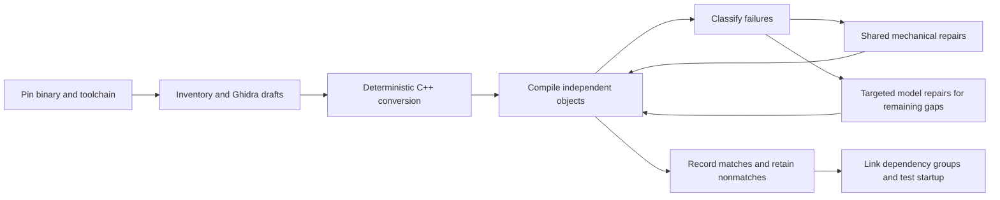

# A reproducible, low-cost decompilation workflow

This is the evolving method developed in DAODecomp, intended to help other game
decompilation projects reproduce both the useful results and the mistakes. It is
not yet a turnkey framework for arbitrary games. Our implementation currently
targets one pinned Windows x86 executable, and we have **not** demonstrated a
runnable replacement for the whole game or completion within $200.

**Current direction:** [replayable SharpRetro decompilation](replayable-decompilation.md)
on `codex/replayable-decompilation`, processing the original inventory in ascending
RVA order with reusable reconstruction/compiler passes. The Ghidra workflow and
measurements below remain preserved on `codex/ghidra-mainline`; they are historical
results and comparison baselines, not inherited acceptance for the new pipeline.

During this early phase, development uses focused tests and a representative
sample initially capped at 16 functions, with complete comparisons for each
selected function. CI is temporarily disabled; full suites and inventory sweeps
are on demand rather than release gates. Historical broader measurements below
remain valid for their recorded inputs. Sample results do not establish coverage
of the rest of the inventory. See the current
[iteration and checkpoint policy](replayable-decompilation.md#the-development-loop).

The goal is functional recovery and a replacement using the original assets.
Exact compiled-function matches are a useful automatic acceptance shortcut; a
byte-identical whole executable is not required. Read the
[learning log](learning-log.md) for dated observations and the
[cost plan](cost-target.md) for measurements and budget assumptions.

The first [C# MCP implementation](decompilation-mcp-usage.md) exposes inventory,
retained C++ and fresh checks of existing compiler artifacts to agent clients.
It shares the current comparison backends; installing it does not yet add new
compilation, automatic source rewriting or a game-independent decompiler.

## The inexpensive order of work



Do not make every function depend on a model call. Do not make generation wait
for every dependency implementation or for handwritten validation material.
Keep compiling sources and useful nonmatches even when matching or execution
checking is not yet supported. Stable address names are sufficient initially;
readability and naming can improve after behavior and integration become clearer.

## 1. Pin the input and inventory what is actually known

Record the executable/module hash, image base, architecture, endianness and
analysis/tool versions. Identify a function with **module hash + module + RVA**.
A VA includes the image base; an RVA does not. Use a single canonical identity
through source names, call/global references, compiler symbols and comparisons.

Export inferred function starts, complete body ranges, raw-byte hashes, direct
calls, imports, referenced data and prototype/type hypotheses automatically.
Keep unknown boundaries, indirect calls, shared tails and missing functions
explicit. A decompiler's function count and prototypes are not ground truth.
Do not exclude difficult functions from the inventory because the first backend
cannot yet compare them.

For the actual DAO import/export procedure and pinned Ghidra distribution, see
[static analysis](static-analysis.md). Original binaries, assets, generated Ghidra
projects, full disassembly and raw evidence stay in ignored local storage. Public
documentation can include source transformations, aggregate metrics and small
synthetic examples without shipping the game's install.

## 2. Produce free drafts, then mechanically normalize them

Use headless decompilation once and retain its output. Export referenced symbols
and data types with each draft so downstream tools do not need to rediscover
identities. Save per-function errors/timeouts as outcomes rather than dropping
identities from the denominator.

Bootstrap C++ syntax with narrow token-aware rules. Examples include canonical
address names, recognized integer-width aliases and well-understood parameter
declaration forms. Comments, strings and longer identifiers must not be rewritten
accidentally. Missing register/stack inputs cannot be replaced with invented values.

Use target-aware AST analysis when the edit depends on expression structure,
pointer width, signedness, lvalues or a calling convention. Get enough declarations
and syntax into shape first: an incomplete recovery AST does not justify arbitrary
rewrites. Keep unsupported cases visible. The current
[compile-first work](compile-first.md) uses the existing Clang executable for AST
information and the historical compiler for final object production.

## 3. Compile without requiring the whole game to link

Generate standalone translation units with provisional dependency declarations,
then compile to objects without linking. This permits caller and callee recovery
in parallel. Declarations are not successful stub implementations.

Select a plausible original compiler family, target, patch and flags using binary
evidence and measured output. Preserve the uncertainty: a PE linker version does
not identify the exact C++ compiler patch. Record the compiler executable identity,
flags and actual build host. Our VC8 x86 compiler runs under Windows 11 ARM64
translation, which is distinct from running on native x86 hardware.

Classify **the first compiler error in each file** as well as the complete log.
One bad declaration can produce dozens of cascading diagnostics. Group repairs
by root cause and use shared transformations rather than one model request per
error message. Rebuild every changed candidate. A separate baseline makes repair
yield and regressions measurable.

Do not treat every decompiler state placeholder alike. Our next round separated
byte-backed `FS:[0]` memory operations from genuinely unresolved register/stack
inputs and lowered the supported accesses to native compiler intrinsics. This
exposed compiler-cookie frame addresses as a separate problem. Keep a complete
inventory while deferring known failures from the next expensive compiler pass;
record the deterministic selection rule and preserve the omitted identities.
See the [FS round and its limits](compile-first.md#round-002-explicit-fs-memory-access).

Before changing a failed call, check declaration closure against the retained
analysis metadata. The [callback declaration pass](compile-first.md#round-005-restore-omitted-callback-typedef-declarations)
restores only omitted numeric callback typedefs with explicit supported signatures
from the same read-only project revision. Missing metadata remains unknown. Its
75/80 compilation improvement produced zero new exact matches, demonstrating why
compilation repair and matching yield need separate denominators.

## 4. Keep compilation, comparison and execution separate

| State | What has actually been observed |
| --- | --- |
| Draft | A decompiler or model emitted a hypothesis |
| C++ emitted | The converter produced source, possibly still invalid |
| Object compiled | The selected compiler accepted the source |
| Full function match | The comparison covered the full supported original range and resolved references under its recorded rules |
| Linked slice | Dependencies and definitions were sufficient for a particular executable build |
| Runtime milestone | That executable actually reached a specified behavior on a recorded host |

Never turn a rounded similarity score, matching prefix, unresolved relocation,
missing symbol, solver timeout or unsupported case into a match. For object
comparison, resolve supported relocations to explicit original identities and
check addends; do not merely mask address operands. The current
[object comparator](object-recovery.md) and earlier [reccmp loop](reccmp-loop.md)
describe their different scopes and limitations.

Use common comparator tests and negative controls to catch false acceptance.
Do not require a handwritten contract, fixture corpus, wrapper and review packet
for every new function. Generated evidence should bind source, original bytes,
compiler/object and comparison inputs automatically. Compilable nonmatches remain
valuable working material, but are not silently upgraded to equivalence.

For already-compiling near nonmatches, try a bounded deterministic AST search
before individual model repair. Our [matching pilot](compile-first.md#bounded-ast-guided-matching-pilot)
uses complete target-aware parses, actual integer types and source spans, a fixed
frontier and at most four variants per pilot function. Comparison and signedness
edits are candidate hypotheses, so every failed variant remains unvalidated.
Instruction similarity only ranks work; a full-range exact object comparison
still decides acceptance. The [indirect receiver follow-up](compile-first.md#bind-indirect-receiver-hypotheses-to-the-observed-call-edge)
shows why a memory-addressing label can require restoring an observed call input
rather than changing field offsets. Its bounded AST rule retains unknown callee
semantics and relies on the same complete comparator. Preserve known exact
controls and count every compiler attempt, including failed exploratory smoke work.

## 5. Spend inference on diagnosed gaps

First run a [deterministic mismatch census](mismatch-analysis.md) over retained
objects. Rank observed differences by both function count and requested body
bytes, excluding identities already matched by another candidate. Keep broad
heuristic labels separate from small, aligned repair frontiers: a primary
stack-cleanup label can coexist with substantial structural differences. Preserve
unsupported comparisons and unknown causes. Typed paired IL is a further
diagnostic layer; do not silently promote structural agreement to equivalence.

Send a model the current draft/source, requested identities, relevant dependency
information and concrete compiler/comparison feedback. Keep complete evidence
locally while avoiding repeated caller lists and unrelated metadata in prompts.
Never truncate the requested function's necessary context without recording that
generation is incomplete.

Measure tokens and outcome separately: reasoning tokens, source output, cache
hits, invalid responses, compilations and **new distinct** matches. A mode that
uses fewer tokens can still cost more per useful result. Our non-thinking pilot
did not justify a wholesale switch away from the prior mode.

Bound retries and stop plateaus. Do not pay a model to fix an unsupported
comparator case, a missing compiler install or a known transport problem. Keep
successful paid responses when only later tooling failed. An ambiguous timeout
must not silently cause a duplicate paid request. Reserve budget before dispatch
and preserve accounting across restarts, splits and repairs.

## 6. Integrate before the budget is exhausted

Objects can compile with contradictory declarations, repeated definitions and
missing data. Generate a canonical definition/dependency inventory; expose ABI,
type and data-layout conflicts rather than selecting whichever version links.
Work outward through coherent startup and application dependency groups.

Track actual milestones: linked startup, original-asset access, menu, save loading,
then specified gameplay scenarios. CRT initialization, globals, imports, TLS,
vtables, exceptions and middleware are real work beyond isolated functions.
Unrecovered dependencies cannot be replaced by success-returning stubs. A hybrid
that still executes original code must be labeled as such.

Reserve inference and engineering effort for integration. Thousands of easy leaf
matches do not establish that complex functions or the whole game will have the
same cost per function.

## Reproducing the current DAO experiment

The repository still contains machine-specific configuration. Use the existing
Python dependencies, analyzed project and Windows compiler described in
[static analysis](static-analysis.md) and [object recovery](object-recovery.md).
For a bounded free sample, from the configured worktree:

```sh
python -m rapid_object.ghidra_seed select --root local/repro-seed --count 200
python -m rapid_object.ghidra_seed export --root local/repro-seed
python -m rapid_object.ghidra_seed convert --root local/repro-seed
python -m rapid_object.ghidra_seed measure --root local/repro-seed
```

The measurement command requires the paid queue to be paused and drained and
shares the VM build lock. These commands make no provider calls or production
match promotions. The Java exporter bounds each invocation to 1,000 RVAs; the
recorded whole-inventory run used 28 chunks. Full export is not full compilation.

Version the input binary, persistent analysis state, exporter, converter, compiler,
flags and comparator. A cache entry must correspond to the actual current source
bytes; a cached status or pathname alone is insufficient. Preserve historical
measurements when a converter changes instead of relabeling them as fresh runs.

## Adapting it to another game

| Assumption to replace or verify | Current implementation locations |
| --- | --- |
| Module hash, inventory and runtime paths | `rapid/packets.py`, `rapid/factory.py`, `rapid_object/catalog.py` |
| Ghidra project, language/compiler specification, exporter bounds | `rapid_object/ghidra_seed.py`, `tools/ghidra/ExportInventory.java`, `tools/ghidra/ExportCandidates.java` |
| Source marker/project identity and stable-name mapping | `rapid_native/response.py`, `rapid_object/build.py`, `rapid_object/symbol_normalize.py` |
| Historical compiler, build flags and VM transport | `rapid_object/build.py`, `rapid_native/pipeline.py` |
| Object format, ISA, relocation semantics and body boundaries | `rapid_object/coff.py`, `rapid_object/compare.py` |
| Target widths, calling conventions and source conversion rules | `rapid_object/ghidra_seed.py`, the additive compile-repair pass |
| Model, request schema, limits, prices and credentials | `rapid_native/propose.py`, `workers/deepseek_packet.py` |

Changing only the executable filename is not a port. In particular, x86 COFF
relocation rules and 32-bit pointer transformations must not be reused unchanged
for another architecture. First reproduce a small stratified sample and known
negative cases on the new target, then expand. Keep the per-game differences
explicit; a reusable configuration interface can follow demonstrated second-game
requirements instead of being designed speculatively now.

## Reusable core and MCP interface

Keep deterministic operations callable without a model: inspect an identity,
compile its C++, compare the complete range, classify differences, lift both
ranges, propose an AST edit and recompile the result. Retained artifact bindings
make these operations reusable across CLI tools and model providers. Discovery,
compilation, exact comparison, diagnostic agreement and publication are separate
states; an MCP wrapper must preserve those distinctions.

The [first MCP slice](decompilation-mcp-usage.md) exposes inventory/source browsing
and fresh checks of retained compiler artifacts. The
[full-workflow design](decompilation-mcp.md) extends this to initial decompilation,
new compilation, deterministic iteration, refactoring and a durable work queue.
It carries compact results and artifact references rather than reimplementing
the compiler, comparator or decompiler in prompts. AST operations such as renaming,
introducing a typedef or extracting a class need explicit symbol/type scope,
previewable edits and recompilation; they remain future capabilities.

Keep generic x86 effects/source manipulation separate from compiler-specific
ABI/runtime interpretations, build recipes and matching rules. Decompiler syntax
conversion is a frontend adapter and per-game identities/paths are project data.
A rule demonstrated for VC8 does not automatically apply to other compilers.
All stages should be available through the same engine operations via MCP or CLI,
including names, types and explanatory source edits after initial matching.

The planned experiment interface uses a versioned JSON stack of transformations.
Trial a recipe against a frozen baseline over the complete inventory, reuse only
exact unchanged stages and inspect gains, regressions, unsupported outcomes and
unrun work. Preserve accepted source until explicit promotion. This provides a
reproducible way to measure whether a targeted fix generalizes, without hand-editing
functions or treating partial experiment coverage as universal success.

The longer-term SharpRetro path makes the binary plus recorded analysis decisions
and transformations the durable input, with C++ regenerated from a shared recovered
IR and compiler-specific passes. Keep names/types attached to persistent entities
and their origin/definition-use lineage; ambiguous changes require reconciliation.
Current SharpRetro integration is diagnostic lifting, so structured recovery and
source emission remain an incremental experiment alongside the Ghidra baseline.
See [binary-backed regeneration](decompilation-mcp.md#binary-backed-replayable-decompilation).

## How to add a learning

Append a concise entry to [the learning log](learning-log.md) when an experiment
or fix changes what we know. Include the symptom and general cause, the rule and
its preconditions, the measured before/after denominator, reproduction/code links,
and what remains unresolved. Record failed experiments too. Add generic synthetic
regression cases for reusable transformations, not bespoke paperwork per game
function. This documentation is part of the ongoing work.


### Diagnose stack deltas before editing ABI hypotheses

A stack-cleanup label can reflect local byte storage, an incomplete call
declaration, or an unknown formal input. The bounded follow-up sampled 33 of
3,658 stack-primary cases, retained two failed byte-store smokes, then tested five
strict leaf-cleanup declaration proposals. All seven attempts compiled but no
complete match resulted; ten unchanged controls remained exact. Unknown high
stack bytes and an unused formal input were left unresolved. The zero-yield
prototype stays private, and the published snapshot remains 2,241 sources. See
the [measured negative result](learning-log.md#stack-cleanup-diagnosis-bounded-negative-result)
for selection conditions, exclusions, timings and retained reproduction steps.


### Predicate spelling without changing signedness

Equivalent integer spellings can expose different historical compiler lowering.
The [signed-threshold experiment](learning-log.md#signed-threshold-spelling-a-small-positive-result)
kept existing signed 32-bit types and changed `-1 < x` into `x >= 0`, with the
corresponding negative predicate form. This removed a CMP-negative-one versus
TEST-zero mismatch in three complete functions. A low-yield eight-case smoke
stopped the wider profile; only two additional threshold-only cases were built.
Three exact / 100 bytes from ten attempts justify this narrow generic rule, while
53 eligible cases remain unrun. Predicate spelling identity is not evidence for
the original signature or whole-game behavior; source promotion still requires
the complete existing comparator and fresh exporter bindings.


### Keep stack cohorts fixed while repairing one cause

A stack-primary cohort can contain call arguments, native exception frames,
return cleanup, spills and partial-value input hypotheses together. Freeze the
identity list and retained source/report selection, partition actual stack facts
with overlaps, then subdivide by source/dataflow evidence. Track both complete
matches and the specific targeted instruction symptom. A primary label changing
to another category does not count as a recovered function.

The [cookie-argument checkpoint](learning-log.md#fixed-stack-cohort-separate-a-cookie-argument-from-its-frame)
measures the full strict eligible subgroup of a fixed 6,487-function cohort.
Its [generic rule](../rapid_object/cookie_call_fix.py) removes only a final pure
cookie-local argument when complete original caller/callee observations and a
complete target-aware AST support the proposal. Other arguments and unknown
frame/callee semantics remain explicit. Reuse completed candidates and preserve
transport unknowns; new source hypotheses still require the unchanged complete
comparator and existing exporter. This DAO-specific helper's image-base/naming
and POSIX-host limits must be addressed before claiming a port to another game
or a Windows-hosted analysis tool.


### Stack repairs compose on retained candidates

`rapid_object.allocator_receiver_fix.rewrite(source, complete_ast, bound_report,
actual_callee_captures)` proposes one allocator-result receiver correction for
the pinned constructor family. It consumes the retained cookie-corrected input,
not a newly rebuilt or reset baseline. Source spans/types, actual complete callee
bodies and bounded original CFG/register/stack provenance must agree; unknown
control transfers, escapes, input/storage or call contexts refuse. Existing
argument expressions and RET4/RET0 distinction remain intact. Suffix data effects
and native exception-frame semantics remain unknown. Only the complete unchanged
comparator and existing exporter can accept/publish a source; a diagnostic
receiver or stack-label improvement cannot. Preserve both the original lineage
and every intervening source/object binding, including inconclusive variants.

The measured 500-input composed checkpoint improved the observed receiver setup
but produced zero new full matches. The largest residual remains the shared
native exception/unwind-frame hypothesis. This preserves the fixed 6,487 cohort
and gives the next iteration a concrete cause to investigate instead of counting
primary-label churn or resetting to pre-repair sources. Generic tests run with
`python -m unittest rapid_object.tests.test_allocator_receiver_fix -v` on the
existing POSIX target-aware Clang workflow. Image base `0x400000` and the named
DAO allocator/constructor family are explicit current limitations.

### Keep generated exception symbols separate from source functions

An embedded source RVA in a compiler-generated name is not its address. Bind
source identities at the start of their actual C/C++ decoration, and keep the
handler, descriptor, unwind table and cleanup actions as distinct graph nodes.
The build and source exporter now share this rule. The complete comparator still
refuses unexamined defined dependencies.

The [exception-graph diagnostic](mismatch-analysis.md#inspect-compiler-generated-exception-dependencies)
consumes original bytes, retained COFF objects and existing comparison inputs;
it requires no authored per-function artifacts. Its current support is bounded
to observed MSVC x86 profiles, including one-state FuncInfo data. Complete node
bytes, relocations and explicit unknowns are retained. This is a way to locate
remaining differences, not an acceptance extension or proof of EH runtime
behavior. Preserve comparator-level refusals as diagnostic errors too: an empty
per-function result after a global refusal must not crash the diagnostic reader.


### Account for every supported exception-graph byte

`rapid_object.eh_graph_compare.compare_graphs(original_bytes, object_bytes,
requested, symbols, module_sha256=...)` extends the bounded graph diagnostic
through the complete main, checked handler, FuncInfo, unwind map, action and
supported delete helper. Each byte is equal, different, absent or explicitly
unresolved. Relocation indexes retain the actual COFF target identity: two
same-name symbols in different sections must not share a placement. Uncompared
defined dependencies remain incomplete.

Node correspondences come from actual reference edges and supported candidate
boundaries. Original inventory boundaries and compiler-runtime identities may
still be missing; these remain blockers even when resolved bytes agree. Unknown
relocation words retain all four byte records and their reasons. The tool never
passes generated-symbol aliases into the existing comparator, and every report
keeps `acceptance_supported=False`. It consumes existing bytes/metadata and
requires no authored per-function packet. Synthetic regressions run with
`python -m unittest discover -s tests -p test_eh_graph_compare.py -v`.

### Compare complete native main and exception graphs

The separately named `i386_coff_eh_graph_v1` backend adds a bounded acceptance path
for complete MSVC x86 main/EH graphs. `rapid_object.eh_native.check` consumes the
original, pinned inventory, actual selected compiler/static-library bytes, C++,
COFF and retained compiler receipt. It derives runtime identities from actual
archive definitions and unique full-span literal/relocation constraints, then
compares the complete runtime roots including every relocation. Candidate main,
checked handler, 36-byte FuncInfo, eight-byte unwind map, cleanup action and delete
helper must all agree byte-for-byte under actual reference-edge correspondence.
There is no address-field masking, source-supplied placement map or missing-node
success. Unsupported larger actions, metadata states, boundaries and ambiguous
identities remain inconclusive. Original helper boundaries use fully decoded,
entry-rooted supported terminal profiles; main boundaries use the pinned inventory.
These are explicit supported-format assumptions, not arbitrary EH CFG support.

The trusted DAO intake in `rapid_object.eh_source_export.DAO_POLICY` binds module,
inventory, compiler, complete static library and retained SDK package hashes plus
compiler flags. Configuration supplies only inventory/compiler/library paths;
it cannot substitute policy hashes or desired original addresses. The selected
static CRT routines are comparison dependencies, never extra recovered C++ rows.
Their immediate dependency identities are independently constrained; transitive
runtime semantics remain external. The original game's compiler patch is unknown.
Compiler receipt trust remains the same limitation as ordinary object matching:
a retained receipt is not cryptographic proof that compilation ran.

Generate a fresh private comparison without rebuilding:

```sh
python tools/check_eh_native.py --original ORIGINAL_EXE --inputs local/eh-inputs.json \
  --build-folder RETAINED_BUILD --output NEW_PRIVATE_CHECK
```

The inputs JSON has `inventory`, `compiler` and `libraries` fields; the last maps
`libcmt.lib` to its retained path. The exporter API
`extend_snapshot(index, files, reports, original_path, eh_inputs=inputs)` accepts
these reports while preserving the supplied existing snapshot. Load the current
published index and its source bytes as the base; do not replace it with an older
queue snapshot. `publish` writes only the resulting C++ and public metadata.
Every EH export reopens all inputs and recomputes the complete comparison. Stale,
forged, malformed or partial reports cannot authorize publication. Input keys bind
source, object, original, inventory, compiler, library, build, policy, implementation,
Python and decoder versions; even a matching cache key does not reuse a verdict.

Published `exact_eh_graph_match` rows keep a distinct status and backend. Metadata
contains hashes, versions, sizes and stable source/RVA identities; private game
bytes, libraries, objects, raw reports and local paths stay ignored. Multiple
functions in one compared translation unit share one source/unit, and duplicate
objects cannot add function credit. The ordinary checker and nonaccepting graph
diagnostics keep their existing behavior.

The constructor spelling is separately implemented in
`rapid_object.eh_construction`: a deterministic unique class per RVA owns its
static new/delete forwarding, preserving the observed allocator, argument
expressions, return convention, vptr store and direct cleanup-tail destination.
It emits no global allocator overrides. Four-byte layout/nominal C++ lifetime
remain hypotheses tested through the historical compiler's complete output;
complete comparisons are the acceptance shortcut. This narrow source generator
is not authorization for a broader rollout. Focused tests cover source binding,
unknown effects, type/context refusal and composition. Compiling the four bodies
together demonstrates same-unit composition, not a linked replacement game.

### Recover one representative constructor at a time

The [median-function experiment](learning-log.md#sequential-median-functions-native-constructors-and-copy-elision)
worked three 109-byte functions sequentially; 109 bytes is the exact median of the
27,555 pinned inventory identities. A complete retained source body and original
instruction profile can support a more precise native C++ construction hypothesis.
`rapid_object.conditional_construction` recognizes a guarded allocation and native
constructor call; `rapid_object.byvalue_construction` recognizes base initialization
and a directly constructed eight-byte by-value argument. Both bind source, original
and complete range hashes, use a complete target-aware AST, derive cleanup edges
from actual original bytes, and refuse unknown source effects. These are bounded
DAO/Ghidra spellings and x86 layout hypotheses, not arbitrary constructor recovery.

An external constructor declaration preserves the compiler's native constructor
return convention. A wrapper that discards an ordinary call's return can force an
extra preserved receiver. The narrow source identity extension recognizes only
MSVC x86 `??0fn_<8hex>@@QAE@H@Z`; other special members, namespace/import/generated
names and unsupported signatures refuse. An explicit copy-constructor declaration
can enable VC8 to elide a temporary copy. No copy implementation is supplied; any
remaining unknown copy dependency must block acceptance.

The supported EH actions now include exactly eight bytes of
`mov ecx,[ebp+signed displacement]; jmp rel32`, alongside the existing eight-byte
address form and eleven-byte delete action. Complete terminal decoding, signed
frame offsets, every relocation and the actual forwarding target remain checked.
The legacy graph node name `delete_helper` denotes the compared five-byte forwarding
node; its label does not establish deallocation semantics for a base destructor.
The constructor identity implementation is included in the native EH input hashes.
Unsupported actions and unknown dependencies remain inconclusive.

The three generic regenerated sources matched all 585 supported main/EH graph bytes,
including all 327 main bytes, after ten actual historical compiler variants. Preserve
the failed variants and measure compiler latency separately from analysis time.
Use the existing fresh snapshot exporter; instruction distance, source recognition
or a matching main alone cannot publish a function. The POSIX Clang source-generation
workflow and the portable complete native graph checker retain distinct host limits.

### Restore receiver context and observed flag widths conservatively

The next sequential median experiment recovered two ordinary 109-byte functions
with `rapid_object.copy_loop_receiver` and `rapid_object.lookup_receiver_flags`.
Both recognize complete retained Ghidra source/AST shapes and complete original
instruction profiles, bind the source and original ranges, and inspect complete
callee control flow and stack cleanup before restoring explicit thiscall receiver
arguments. A direct receiver capture or unchanged forwarding to an unknown nested
call is evidence of context only. Any ECX, CX, CL or CH write before that evidence
refuses. Unknown callees receive declarations, never invented implementations.
The copy-loop destination advance uses defined unsigned 32-bit wrap. Explicit byte
casts on shifted flags preserve the observed byte tests rather than combining them
into wider masks. These are bounded source hypotheses, checked through real VC8
output by the unchanged complete object comparator.

`rapid_object.numeric_loop_spelling` retains a useful numeric-parser hypothesis:
unsigned accumulation and a condition-based next-character lookup recover the
observed register roles. Its retained 100-byte candidate still differs from the
109-byte original in radix materialization and loop alignment. It is a nonmatch,
not eligible for export. Preserve the failed variants and unresolved table layout;
source recognition and shorter code cannot confer acceptance. The sequential
experiment used fourteen compiler variants and exports only the two full matches.

The lookup rule also supports positive short decimal/hexadecimal type literals
only when the complete original CMP immediate agrees; it refuses zero, values
above 127 and octal spellings. This permits reuse across retained siblings while
preserving full instruction-profile, callee-context and unique marker checks.

`rapid_object.bounded_copy_window` recognizes one complete page-window source
shape and original profile, then emits defined unsigned32 arithmetic and a direct
negative early return before the optional copy block. The existing signed-threshold
rule can observe a 32-bit SUB followed by one fullword copy and JS/JNS; JL/JGE do
not establish the wrapped result's sign when subtraction overflows. A signed-zero
rewrite can improve the branch encoding while still changing register assignment.
Only a complete successful comparison can export the final structured spelling.
All original calls and their unresolved semantics remain external. Preserve failed
source and type-order experiments alongside the successful generic regeneration.

### Keep unknown list and callback effects explicit

`rapid_object.copy_chain_receivers` and `rapid_object.checked_list_receivers`
recognize complete retained field-copy/list and checked-list source shapes. Their
complete original caller profiles and complete recorded callee ranges support
restoring direct and virtual receiver contexts. A repeated source expression can
compile into a second field load; explicitly retaining the one observed receiver
value can recover the original load/test/call sequence. Preserve every original
error-handler edge without supplying missing error or virtual-call semantics.

The shared callee-context reporter has an explicit optional mode for recording
unknown 32-bit indirect calls after prior observed receiver context. The default
still refuses them; an indirect call alone cannot prove context. Recorded return
instructions and a complete normal CFG do not establish effects or termination of
unknown nested calls. All targets and semantic outcomes stay unknown.

A callback-array caller can suggest an ABI spelling from its pushes and caller
cleanup pattern, but that remains a source hypothesis. The retained
`callback_array_spelling` rule restores that spelling and an unsigned ordered-zero
test while preserving defined unsigned32 wrap. Its current output still fails the
complete comparator because register assignment and bounds-check scheduling differ.
Keep it private and retain the failed helper/type/orientation experiments. A source
recognizer, a shorter candidate or a plausible calling convention cannot export it.

### Preserve instruction form through symbolic recovery

A resolved value and its original instruction form answer different questions.
For a deliberately direct-only tail-call rule, checking that the evaluated jump
target is constant is insufficient: loading a constant into a register and
jumping through that register also resolves to a constant. Preserve the original
typed operand or independently decoded branch form and enforce the domain before
constant propagation. Test both unknown and known indirect targets.

Whole-inventory applicability classification must use the same domain as the
actual transformation. If the scanner excludes indirect jumps while the
transformation admits some of them, the scan cannot claim complete coverage of
affected outputs. Account for every identity, keep generated hypotheses separate
from compiler/comparison outcomes, and run affected output checks after the
machinery is reviewed. A successful discovery example does not replace those
checks.


### Durable targeted regression checks

The tail-rule scan exposed an execution gap: its 207 additional hypotheses could
not be compiled through the ascending frontier operation without skipping the
unresolved earlier function. The bounded correction adds explicit inventory-ID
target selection to the same durable submission and execution path. Regression
rows use a reserved key namespace in the existing queue table; old clients still
observe their active/unknown barriers. Current artifact-bound counts remain
separate from recovery rows. Both
modes retain the project-wide running/unknown barrier, exact input bindings,
idempotency and shared compiler lock. An optional generated-source digest refuses
a changed scan hypothesis before compilation. This operation adds no new
transformation semantics; publication and measured affected-corpus outcomes are
recorded separately after independent review. Two development targeted MCP checks
passed complete 22/22-byte and 11/11-byte comparisons on macOS ARM64 driving the
existing Windows 11 VC8 compiler. A wrong regenerated-source digest refused before
compilation. The unchanged retained adapter additionally checked each actual
object and its ordinary/EH gate; no object check can upgrade an earlier failed
comparison. These controls are not the affected-corpus result.


The reviewed targeted operation was published and installed after both exact-head
CI workflows passed on Linux, macOS and Windows. Fresh installed ordered controls
again matched 22/22 and 11/11 bytes. The affected batch then matched **39 of 208**
hypotheses completely before its 40th dispatch, at RVA `0x000d5890`, returned a
Parallels transport error without a compiler exit marker. That attempt remains
**external outcome unknown**; **168 hypotheses are unrun**. It was not retried.
The project-wide barrier refused subsequent generation requests in both modes.

Combining the 39 regression matches with the two compiling controls gives **40
unique current native object matches**, a gain of 38 ahead identities in this
new pipeline. Recovery still stops at `0x1040`; no source was exported and no
historical source count was added to these results. All 27,555 scan rows are
accounted for separately from these comparisons. The affected batch retained 39
confirmed compiler exits; the failed dispatch does not establish whether its
remote compiler ran. Raw evidence remains private under
`local/replayable-regression-001/`. Reconciliation of the existing unknown attempt
requires separate authorization and must preserve its history.

### A nonaccepting transport boundary

Missing output is insufficient evidence of compiler failure. At the interrupted
affected-corpus dispatch, the exact guest workspace and host/shared launch input
were absent, the mapped parent directories were reachable, and no other compiler
or command shell was active. The registered launch protocol synchronously copies
that input before compilation and stops on a failed copy. These checks support a
bounded quiescence observation while leaving the original compiler outcome
unknown; they do not recover or accept a candidate.

The durable abandonment operation requires those observations under the existing
shared VM lock, ownership of the old worker claim, exact retained source/request
bindings and an attested synchronous transport profile. It atomically records a
new **nonaccepting** result and releases only that attempt's barrier. The old
unknown history remains unchanged. It refuses existing artifacts or workspaces,
other launchers, changed inputs, inaccessible directories and transport ambiguity.
It never retries compilation automatically. Continued corpus checks can use the
unchanged approved execution runtime and retain completed results under their
original bindings; a different generator runtime receives no transferred credit.


### Completed affected-corpus continuation

After independent review and all-three-host CI, the exact frozen transport
runtime recorded a fresh **nonaccepting abandonment** observation for the old
dispatch. Its original request/result remain external-outcome-unknown. Fresh
installed ordered controls again matched 22/22 and 11/11 bytes. The unchanged
earlier execution runtime then checked the 169 remaining candidates explicitly;
39 completed results were verified and retained without recompilation or credit
transfer to the new runtime. No further uncertain outcome occurred.

The complete affected set is **203 full matches and five mismatches out of 208**,
with **zero unrun**. Rejected RVAs are `0x13cc50`, `0x4e0da6`, `0x4e893a`,
`0x4e8bda` and `0x57b780`; neither checker accepted a prefix or changed its gates.
All 27,555 inventory rows are accounted for: 208 compared candidates and 27,347
outside this affected domain. Including the first control gives **204 unique
native object matches**, a gain of 202 over the initial two. These are pinned
compiled-object observations, not source exports or game-execution evidence.

The continuation retained 169 confirmed compiler exits totaling 230.621 measured
compiler seconds. The recovery frontier remains `0x1040`. The separate addressable
stack-argument prototype has only offline generation evidence and was excluded
from this reviewed transport release. Private receipts and complete rejected
results remain under `local/replayable-transport-001/`.

### Derive bounded callee cleanup without inventing call effects

An opt-in composed recipe can retain an existing profile's supported domains and
add a bounded stack-parameter rule. First run the established recovery/emission
path. If it refuses, derive direct call targets from the actual original
instruction operands, require exact inventory entries, and lift those original
ranges through the same pinned frontend. Bind the full module, inventory, lifter
source/runtime closure and generated evidence. A propagated register constant is
not an original direct-call operand.

For normal-return cleanup, require a complete reachable callee CFG, internal
branch closure and uniform return encodings whose typed stack effects agree.
Keep the result explicitly hypothetical: unknown nested calls can fail to return
or alter state. The caller's incoming extent, outgoing argument slots, callee
cleanup, outer return cleanup and preserved registers remain separate obligations.
The initial profile supports one addressable four-byte input forwarded as one
argument under the explicit flat32 VC8 ABI. It does not rewrite unknown calls as
zero returns or no-effect summaries. Unsupported symbolic offsets refuse instead
of overflowing the recovery process. Real source/object comparisons still decide
whether a generated candidate matches its complete original range.

The added-rule applicability scan accounted for all 27,555 inventory identities
in 45.910 seconds on macOS ARM64. It generated two unchecked source hypotheses:
one is the already compiled pilot and one still needs comparison. Necessary
static preconditions excluded 27,012 identities; actual typed checking refused
534 more, and seven dependency analyses could not use discontiguous original
callee ranges. Those seven remain unresolved, not successful. The composed recipe
retains prior domains, but this denominator measures the added rule only. It grants
no new-runtime credit to the 204 retained earlier object matches. The final
630-test suite (33 skips), standalone 65 tests (two skips), seven CTest checks and
both 59-case synthetic demonstrations passed; the negative demo detected six
mismatches. These generic tests do not establish game equivalence.


After cumulative independent approval and exact-head CI on all three hosts, the
frozen runtime was installed immutably. Fresh ordered checks passed at 22/22,
11/11 and 25/25 bytes. Both added-rule candidates have now passed complete native
object comparison: the same-binding ordered stack control was retained without
recompilation and the other candidate used the public targeted operation with its
expected regenerated-source hash. The 204 earlier matches were independently
checked for unchanged input/artifact bindings and retained under their original
runtime; no matching credit was transferred to the new recipe.

There are now **206 unique pinned native object matches**, a gain of two in this
stack-argument iteration. The selected recipe has three ordered matches and one
ahead regression match. Its first unresolved function is `0x1070`: original-derived
callee CFG evidence has an external or misaligned exit, so generation refused and
no compiler was launched. The function also contains conditional caller control
flow outside this added linear rule. No further rule was implemented. The prior
five tail-call mismatches remain rejected. Both added-rule candidates are checked,
with zero unrun or new uncertain compiler outcomes; seven discontiguous-callee
analyses remain unresolved. All 27,555 rows have explicit applicability/accounting
records. There are still zero new source exports and no game-execution claim.

### Preserve call identity while forwarding ABI evidence

A pure forwarding thunk does not justify retargeting a source call. Require its
complete original body to be one direct unconditional near JMP with no other
typed effects, resolve a unique exact inventory target, preserve every chain
range/hash and enforce cycle/depth bounds. Reuse complete reachable-CFG/uniform
RET analysis only at the terminal body. Attach that normal-return hypothesis to
the **original** call target; leave nested calls, memory effects and termination
unknown. Do not infer formal arity from cleanup zero.

For a bounded conditional region, process every typed effect and keep explicit
states at the join. Equal live frames and preserved registers are required;
differing volatile state remains unknown. Retain typed flags even when the native
ABI does not require their exit values. A by-value outgoing word and a caller ADD
are distinct from callee-pop cleanup. An incoming byte read after a call refers
to current storage, so it must not become an assumed unchanged pre-call value.
Reject known frame-address escapes and unsupported joins instead of pretending
a callee has no effects. The initial implementation supports one forward diamond
and a narrow flat32 VC8 source profile; it is not a general CFG decompiler.

A real first pilot matched the entire 36-byte original function using those
reusable rules, with the three prior ordered controls also matching. Its source
kept the original forwarding-thunk target. A separate SDK transport failure was
handled through the previously reviewed nonaccepting operation and an explicit
new request; its unknown history remains unchanged. Compiler/object matches are
pinned native observations, not proof of callee semantics, source-type consistency
across the executable, or game execution.

The final added-rule scan assessed all 27,555 inventory identities in 128.016
seconds on macOS ARM64. Necessary static preconditions excluded 26,473 identities;
actual typed checking generated 577 hypotheses and refused 389 cases. Another 116
dependency analyses remain unresolved: 95 incomplete/opaque lifts and 21
discontiguous callee ranges. The earlier profile generated none of those 577
conditional hypotheses. At the pre-adoption freeze, one was the 36-byte pilot; the other 576 were
unchecked. Generated-candidate rows and C++ stayed identical across the known-frame-address escape
guard, which now refuses 12 known frame-address escapes earlier. This is
applicability, not comparison credit. The final 652-test suite (33 skips),
standalone 87 tests (two skips), seven CTest checks and both synthetic demos
passed; the negative demo detected six of 59 case mismatches. Prior 206 native
object matches remain under their exact original bindings, with zero source
exports. That pre-adoption freeze required independent approval and fresh installed
checks before adoption.

The first cumulative review rejected a real private-frame alias defect: a word
store at entry-SP minus one overlapped the saved return address, while the word
slot model retained its old value. The rejected freeze and actual typed-lift
counterexample remain preserved. The bounded repair requires each private word
store to be aligned relative to entry SP, fully inside the allocated negative
frame, and ordinary SP adjustments to remain aligned and nonpositive. Generic
boundary tests and the actual counterexample now refuse; all four ordered native
controls still match with unchanged generated C++. The corrected whole-inventory
scan rows are byte-identical: 577 hypotheses, including 576 still unchecked.
No full comparator was changed, and no false full match was claimed.

The corrected freeze `064dbaf9...a1ccd5f` was independently approved and its exact
source published at `46740b9`. Both CI workflows passed on macOS, Linux and
Windows. Immutable runtime `d2a6ea970751ead1` then passed fresh installed ordered
checks at `0x1000`, `0x1030`, `0x1040` and `0x1070` (22, 11, 25 and 36 bytes).
The next ordered identity, `0x10c0`, remains inconclusive with
`unsupported_conditional_input_extent`; no further rule or queue skip was added.

The installed runtime regenerated and checked all 577 affected candidates through
existing durable MCP jobs: 576 full native-object matches, one rejected mismatch,
and zero unrun candidates. At `0x476650`, both unchanged full-range gates reject
the 38-byte object against the complete 45-byte original. The prior five rejected
tail-call candidates remain rejected. The 576 new distinct matches plus the 206
retained identities give 782 distinct native-object matches under their recorded
bindings; 579 matches use the current recipe (four ordered controls plus 575
targeted jobs). Ahead regression results do not move the `0x10c0` frontier.

Ten affected-batch transport-unknown attempts remain unchanged in history. Each
continuation followed a separately invoked, reviewed nonaccepting recovery
operation with fresh bound evidence; completed jobs were reused and no unknown
attempt received match credit. Including author variants and installed controls,
this scope retained 608 managed build attempts: 596 confirmed compiler exits
(831.321 measured compiler-host seconds) and 12 uncertain attempts. No active
uncertainty barrier remains. All 27,555 scan rows have explicit accounting;
26,473 outside-domain rows, 389 typed refusals and 116 unresolved dependency
analyses received no new conditional-match credit. Receipts are under ignored
`local/replayable-conditional-calls-001`. Accepted source exports and game
execution remain zero; these are compiled-artifact observations.

The next bounded author pilot reconstructs a two-exit VC8 EH frame from typed
original effects. Generic path recovery keeps the FS registration/restoration,
cookie/state words, ordered memory reads and stores, original call targets,
unknown external results, and each return arm. Return cleanup is recorded
separately from the minimum observed incoming read extent; a plain `C3` does not
establish zero arguments. The compiler profile derives its candidate class/new
spelling from that IR, a complete normal receiver-return relation, and original
PE/EH dependencies. These source ABI and layout choices are hypotheses, rather
than claims about allocator, constructor, cleanup, or common-handler semantics.

The first candidate used C linkage and `/GS-`: the generated 35-byte body did not
satisfy the existing selected compiler/EH policy. C++ linkage with the registered
`/GS` profile produced a 110-byte main plus all five required dependent EH nodes,
197 bytes in total. The original checker then retained 193 equal bytes and four
unresolved relocation bytes: its deliberately narrow source-name recognizer did
not support the zero-argument constructor spelling. The separately authorized
capability extension recognizes only the fully anchored x86 public `__thiscall`
`??0fn_<eight hex digits>@@QAE@XZ`, alongside the existing signed-int form. It
keeps dependency RVA lookup and full graph/range checks unchanged. Wrong targets,
wrapped/generated names, other special members and conventions remain rejected.
The changed shared checker creates a new pipeline binding; historical results
retain their old bindings.

An author MCP pilot reported complete checks for the four earlier
controls and `0x10c0`, including all 197 EH graph bytes. Its failed variants and
the prior unresolved report remain under ignored
`local/replayable-eh-frontier-001`. That pilot preceded cumulative independent review
and installation; it granted no installed-release, source-export or game-execution
credit. The prior 782 distinct bound object-match observations remain historical.

The final added-rule scan accounted for all 27,555 original inventory identities:
one generated EH hypothesis (`0x10c0`), 238 typed refusals, 54 unresolved dependency
analyses and 27,262 rows outside the added necessary domain. It performed no VM
compiles or comparisons and grants no credit. The single hypothesis is covered by
the author pilot; installed checks initially awaited review. Final local checks on
macOS ARM64 passed 678 Python tests (33 skipped), 107 standalone MCP tests (two
skipped), all seven CTest checks and the two synthetic demonstrations (59 positive
cases; six expected negative mismatches). Twenty retained author build attempts
used 28.381 measured compiler-host seconds; no attempt in this scope was uncertain.

The EH checkpoint is now independently approved and published as `86ccd2e`.
Both exact-head CI workflows passed on macOS, Linux and Windows. The immutable
`392438798beabd10` release is installed with the prior `d2a6ea970751ead1` release
preserved. Fresh installed MCP checks passed `0x1000`, `0x1030`, `0x1040`,
`0x1070` and `0x10c0`; the last accounts for all 197 required main/EH graph bytes.
The one added-rule candidate was retained from that exact same-binding installed
ordered job after source/object/report/dependency hash checks, avoiding a duplicate
compile. The added set is one full match, zero mismatch/unknown/unrun. There are
783 distinct historical bound native object matches (782 retained plus one gain),
with five fresh matches under the selected EH recipe. No old binding credit was
transferred: the constructor identity capability changed the checker/pipeline
binding, and its previous source version and all old artifacts remain preserved.

The installed ascending frontier is `0x1130`. Its final EH fallback reports an
unbound handler prefix, but separate read-only characterization finds no FS root
in the caller: the earlier conditional refusal is an unsupported callee exit.
The called `0x1030` has an ordered store before a tail jump, so it cannot be treated
as a pure forwarding thunk. No next-rule implementation or compiler attempt was
made for that body. This checkpoint used 25 confirmed managed compiler attempts
and 35.376 measured compiler-host seconds, with zero new uncertain attempts.
Thirteen prior completed unknown attempts remain unchanged and no active project
uncertainty barrier remains. Accepted source exports and game execution are zero.
Receipts, the full 27,555-row accounting and rollback registration are under
ignored `local/replayable-eh-frontier-001`.

The current development composition adds guarded normal-return ABI evidence for
effectful store-and-tail adapters. Complete pinned adapter bytes and typed effects
remain dependencies; the emitted caller retains the original external call and
unknown effects. Only bounded receiver-relative constant stores followed by an
actual direct jump, with unchanged architectural stack and explicit ABI argument
mapping, enter this domain. The terminal body must independently provide complete
normal-return evidence. A non-FS caller keeps its actionable earlier recovery
error instead of acquiring an unrelated EH-prefix error.

The development pilot matches `0x1130` across its complete 30 bytes, with fresh
prior controls including the 197-byte EH graph. This is provisional; reviewed
released evidence remains 783 distinct native object matches. The next identity,
`0x1150`, remains unsupported: its caller requires partial private-stack writes
and multiple outgoing arguments, and the pinned original callee has an opaque
multiply. The implementation does not skip that frontier or interpret missing
callee semantics as success. Frozen background scans/tests separate applicability
from actual comparison; a cumulative machinery checkpoint follows a coherent
milestone, with final outcome receipts retained locally for the next checkpoint.

For this stable version, all 27,555 inventory rows are accounted for. The frontend
generates 626 conditional-domain hypotheses; 577 also generate under the installed
baseline and 49 are added. The 49 added outputs pass the complete existing native
object checks with exact source/dependency/artifact bindings. They remain
provisional until cumulative machinery review and adoption: 832 provisional
distinct observations versus 783 reviewed historical observations, zero accepted
source exports and no game-execution claim. Earlier unchanged domains are retained
with their original bindings; applicability is never substituted for comparison.


Initialized private subword updates now retain untouched word bits in shared
recovery. Outgoing push provenance distinguishes argument bytes from private
cleanup, and minimum incoming reads remain independent of return cleanup and
formal arity. The compiler profile may use aggregate ABI carriers and distinct
volatile parameter accesses as candidate spellings of observed dataflow. It must
retain unknown padding/results/effects and pass the complete original/object/EH
checks; source generation alone earns no credit. The 43-byte `0x1150` development
match followed a retained 35-byte nonmatch. The next 49-byte cyclic-memory identity
remains unsupported, with no source or acceptance claim.

A dependency update is separately built and attested, including source, adapter,
runtime and explicit undefined-value behavior. It changes input bindings; prior
matching artifacts are historical observations, never silently promoted into the
new key. Stable validation uses a frozen representative sample in ordinary
background processes, while implementation continues where independent work is
available. The cumulative review includes dependency adoption, source rules and
any concrete binding/transport fixes together; final installation receipts stay
local and join the next combined public checkpoint.

### Keep cyclic memory observations explicit

A bounded x86 graph pass can recover loops without unrolling them or treating
memory as a dictionary of independent words. Split actual typed instructions
into blocks, retain ordered loads/stores and width-bearing expressions, require
consistent wrapped SP at joins, then find dominance backedges and their natural
loops. Refuse external/misaligned edges, irreducible cycles, unsupported effects,
unknown consumed predicates and budget exhaustion. Register joins and memory
histories are separate: an arbitrary pointer store may change saved words or the
entry return target, even when its address does not syntactically mention SP.

The first compiler profile over this graph supports one bounded guarded
count-down loop with an invariant source address, wrapped destination stride and
alternating word reads/writes. The stride, offsets and transfer count are derived
from the graph. A null destination can skip one iteration and become nonnull
after wrapped advancement, so the null guard remains inside the loop. Count zero
must bypass pointer preparation. No bulk-copy, nonalias, formal-arity or universal
termination fact follows from this recognition. Source return spelling, register
allocation and ABI frame layout remain compiler hypotheses checked by complete
original/native comparison.

For bounded forward control, factor only identical ordered effects at a common
original instruction point into a structured tree. Original call targets and
all per-path entry snapshots remain in shared IR. A cdecl source signature based
on observed outgoing words is a compiler candidate, not a proof that a callee
has no other dependencies. After potentially aliasing stores, retain fresh
private-stack/return-target reads; do not reuse an abstract saved value. Refuse
later calls when their outgoing stack state would otherwise come from stale
forwarding. Word accesses can use small memcpy intrinsics to avoid alignment and
C++ effective-type assumptions, with guest-address arithmetic remaining unsigned
32-bit arithmetic before the selected native boundary.

Compiler differences still matter to the automatic native acceptance path.
Batch 003 obtained a provisional complete 49-byte loop comparison after retaining
failed scheduling variants. Its next 74-byte function still differs in one
base/index address encoding and remains rejected. Neither an equal instruction
count nor an equivalent-looking disassembly is a complete match. Representative
checks remain bound to their exact runtime and inputs; outside-sample identities
are unverified under new rules, and no source export or whole-game claim follows.

An undefined value's diagnostic reason is provenance, not identity. Independent
undefined occurrences must not compare equal merely because their descriptions
match. Give occurrences explicit identities with correct capture semantics, or
refuse the operation conservatively; never let ordinary equality simplification
invent a known predicate. Similarly, source formal types must preserve every
observed incoming read width. Reading the low halfword of `0x10000` yields zero,
while an untruncated word does not. The current forward-memory source profile
refuses halfword inputs rather than silently widening them. The first batch-003
review's rejected freeze and both open counterexamples remain part of its
transformation history; a passing native sample did not waive those repairs.

### Check encoding relations without erasing semantic differences

A strict full-range comparison is a useful first gate even when byte identity is
not the goal. Keep its actual nonmatch and resolved relocation evidence, then
apply a separately versioned, explicit architectural relation. Do not silently
rewrite the original bytes or accept a broad effective-match flag. Equivalent
looking instruction counts or unconstrained IR equality can hide changed values.
A standalone pinned reccmp helper probe, for example, accepted both a safe address
operand swap and an unsafe incoming-register substitution; it was not a full
linked-image/PDB validation run.

The first bounded relation in this implementation covers one Bits32 MOV immediate
store with scale1 and default DS, whose distinct base/index registers exchange
roles. Both registers must avoid ESP/EBP and no-base/no-index encodings; widths,
immediate, displacement, prefixes, instruction boundaries and all other relocated
bytes must agree. Refuse unresolved/overlapping relocation, incomplete range,
changed effect or control target, and direct instruction-interior or unknown
indirect edges. Existing complete EH requirements stay in force; a main-only
relation cannot repair missing exception dependencies.

Independently lift both actual changed instructions with the attested frontend.
Accept only the explicit capture of `Zext64(Trunc32(affine unsigned addition))`
followed by the same constant-width store through that capture. Canonicalize its
register coefficients and constant modulo2^32. Preserve ordered effects, unknown
values and flags; do not use diagnostic strings as value identities or zero an
unsupported expression. Retain raw typed trees, normalized relation and complete
input hashes automatically. The paired store uses the same effective address,
width/value and DS/fault context. This does not prove object validity, unmodeled
calls, code-byte observations, asynchronous behavior or arbitrary interior entry.

The replayable pipeline uses an opt-in checking recipe with unchanged source
emission and independently runs its first and retained-artifact gates. Both must
agree on the accepted mode. `full_match` and `encoding_equivalent` have separate
queue/status counts, and only current bound recovery results advance the ascending
selector. A result JSON or saved proof flag is never sufficient: compare it with
the durable job, verify source/object/compiler/envelope and retained-request
bindings, then freshly recompute the comparison and typed relation. Missing or
stale evidence remains nonaccepting across restart or version changes. Keep
`proof=false` for universal function-contract and game claims.

Compiler diagnosis is useful alongside this checking work. Holding one target
body fixed across12 CU/name contexts produced identical target code, and authentic
VC8 RTM/SP1 cohorts produced identical fully relocated bodies in24 paired sampled
observations across a bounded flag matrix. One additional pair stayed inconclusive
because an outlined dependency was not bound. These are measured negatives for
those contexts/cohorts, not proof of a unique original compiler or universal CU
invariance. Preserve the unsuccessful configurations, separate library/utility
provenance from game-build provenance, and avoid adopting unsafe object bounds or
arbitrary source spellings just to influence an interchangeable SIB choice.

The experimental `x86-bits32-terminal-aware-typed-receiver-v1` recipe adds
`lower-vc8-packed-observed-receiver-word-fields-v1` to the terminal-aware
composition. Its initial implementation covers mutable forward memory paths:
fixed nonoverlapping, relatively word-aligned 32-bit receiver slots become
neutral `unsigned int field_<offset>` members with unknown-byte gaps. Packed
layout and compile-time offset checks are compiler-profile hypotheses; observed
width is not an original declared type, field extent, allocation size, or array
bound. Dynamic accesses and ambiguous slots use the existing raw fallback.
Original memory effects and ordering remain in IR, and complete native comparison
still determines the result. The original recipes remain available unchanged.

The separate ABI-event experiment is currently nonaccepting. It retains the
strict mismatch and reports a conditional diagnostic; queue selection and match
counts cannot accept that result. Its ordered-memory/boundary-state obligations
do not establish full fault CONTEXT equality or ordinary exception unwinding.
The pending user observation-scope decision does not itself authorize excluding
ordinary propagation/unwinding. The installed release and accepted frontier stay
unchanged until an exact reviewed acceptance policy is actually authorized.

The opt-in `x86-bits32-terminal-aware-scalar-source-v1` recipe extends the typed
receiver composition with
`compact-captured-instruction-local-unsigned-scalars-v1`. This compiler-profile
source pass uses typed definitions/uses, rather than textual substitutions. It
inlines single-use pure 1/32/64-bit expressions only when every transitive use
precedes any dependent register/flag overwrite and no intervening memory/control
event occurs. Multiple uses remain captured, bounding expansion. Loads, undefined
values, subword captures, unfamiliar operators and shifts are not selected for
inlining. Supported low-32 unsigned cast identities simplify views without
changing the shared recovered IR or moving effects across instructions. Original
recipes and sources remain available. Source simplification is not match credit;
complete native comparison and the existing strict/SIB outcome labels still apply.
Deferred source predicates also count as uses. The zero-branch renderer can retain
a captured TEST operand beyond its defining instruction, so the scalar plan
explicitly keeps those captures materialized. A register write that preserves
flags must never change the later branch's captured operand.


Explicit replayable source export is a separate durable operation. It takes a
bounded selection of completed accepted replayable job IDs and expected project/
publication revisions, regenerates current source and requires byte equality with
the historical compiler input. It then rechecks both retained comparison gates,
including required EH dependencies and fresh typed SIB evidence. Old result
labels, source text or diagnostic files cannot independently authorize export.
Historical compiler/group receipts and exact input bindings remain mandatory;
no compiler dispatch is needed for these source-equal artifacts.

Publication projects C++ plus an allowlist of hashes, identity/ranges, recipe,
frontend revision and checker versions. Private paths, original bytes/IL, full
reports and compiler/object files remain local. An independent namespace keeps
historical recovered sources intact. The latest index describes an explicit
1–16-unit snapshot; earlier immutable export folders remain preserved. Index
reads check source hashes and the completed durable export revision. Unknown or
interrupted publication does not gain success through retry or version changes.
These independently compiled wrappers still need type/symbol/ODR integration;
export is neither new function-match credit nor a linked executable or game proof.
